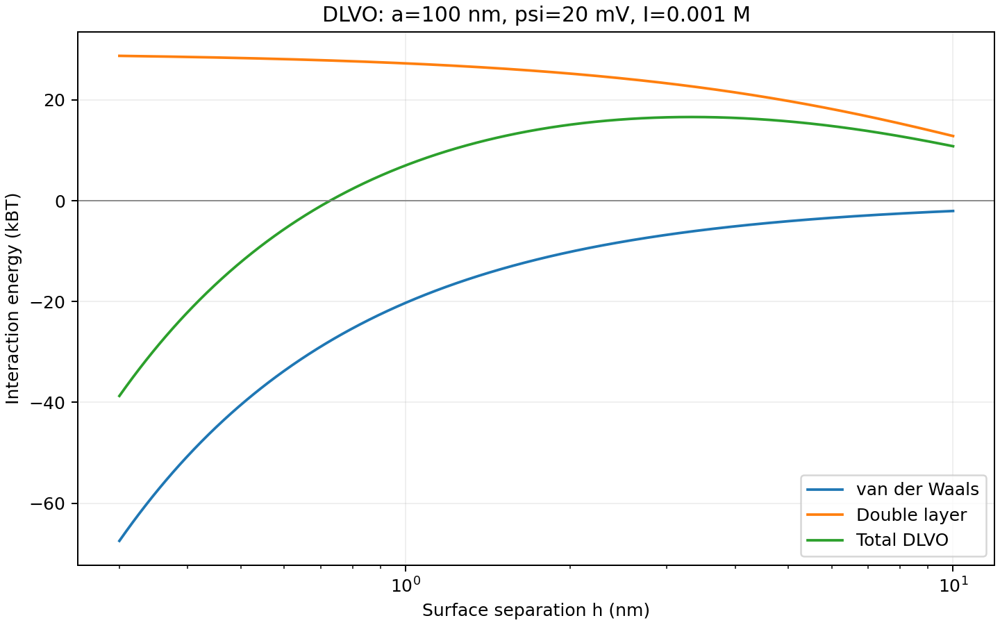

# DLVO計算

BaTiO₃／エタノールの条件探索は[計算レポート](studies/batio3_ethanol/REPORT.md)を参照してください。
非線形PBモデルを使い、粒径・表面電位・自由イオン強度・Hamaker定数を振った結果を保存しています。

同一半径・同一表面電位の球状コロイド粒子2個について、DLVO相互作用エネルギーを計算します。
ファンデルワールス引力、電気二重層反発、およびその和をCSV・PNGに出力します。

## 実行

Python 3.10以上が必要です。

```bash
python -m venv .venv
source .venv/bin/activate
python -m pip install -e .
python -m dlvo
```

既定条件は、粒子半径100 nm、表面電位20 mV、イオン強度1 mM、Hamaker定数1×10⁻²⁰ J、
温度298.15 K、溶媒の比誘電率78.5です。物質を特定した実測値ではなく、計算例の条件です。

```bash
python -m dlvo --radius-nm 100 --potential-mv 20 \
  --ionic-strength-m 0.01 --hamaker-j 1e-20 \
  --h-min-nm 0.3 --h-max-nm 10 --points 1000 --output results/salt-10mm
python -m dlvo --help
```

`--ionic-strength-m`の単位はmol/L（M）です。対称1:1塩では塩濃度に等しく、陽イオン・陰イオン濃度の合計ではありません。
`--potential-mv`は表面電位であり、ゼータ電位を自動的に同一視しません。
温度を変えた場合、比誘電率は自動補正しないため`--relative-permittivity`も適切に指定してください。

出力先には以下を保存します。

- `dlvo.csv`: 表面間距離nmと、各エネルギーのJ・kBT値
- `dlvo.png`: 引力・反発・合計のグラフ
- `summary.json`: SI単位の入力条件、Debye長、計算範囲内の最大値、近似条件の注記

`examples/`には既定条件で実行した結果を同梱しています。



## モデル・式

表面間距離をh、粒子半径をa、両粒子の表面電位をψ、溶媒の誘電率をε=ε₀εᵣとします。
エネルギーの基準は無限遠で0です。

```text
U_vdW(h) = -A a / (12 h)
U_EDL(h) = 2π ε a ψ² ln(1 + exp(-κh))
U_DLVO(h) = U_vdW(h) + U_EDL(h)
κ² = 2 N_A e² (1000 I) / (ε k_B T)
```

Iはmol/L単位のイオン強度です。電気二重層項は低電位の線形Poisson–Boltzmann理論と
定電位境界条件を使ったHHF式を、同一球・同一電位の場合に簡約したものです。
両項にDerjaguin近似を使い、h≪a、κa≫1を想定します。引力は非遅延近似です。
低電位近似は|eψ/(kBT)|≪1で成立し、既定の20 mVでも定量精度に制限があります。
CLIは電位・幾何条件の目安を超えると注記を出しますが、その閾値は精度保証ではありません。

分子スケールの水和力、立体反発、表面粗さ、電荷調節、非線形PB、多価イオンの相関効果、
遅延効果は含みません。接触h=0では引力が発散するため、正の最小距離を設定します。
計算範囲内の最大値は離散格子上の値であり、局所極大の精密探索や、二次極小からの活性化障壁ではありません。
最大が端点にある場合は`summary.json`の`at_grid_boundary`がtrueになります。

参考資料:

- Hogg, Healy & Fuerstenau (1966), [Mutual coagulation of colloidal dispersions](https://doi.org/10.1039/TF9666201638): 低電位における球状粒子間の電気二重層相互作用。
- [Van der Waals interactions between silica spheres and metallic thin films created by e-beam evaporation](https://www.sciencedirect.com/science/article/abs/pii/S0927775712004748): 非遅延平板間エネルギーとDerjaguin近似の扱い。

## Python API・検証

```python
from dlvo import Parameters

p = Parameters(radius_m=100e-9, potential_v=20e-3, ionic_strength_mol_l=1e-3)
vdw, double_layer, total = p.energy_j(1e-9)  # 表面間距離1 nm、出力J
print(total / p.thermal_energy_j)
```

```bash
python -m unittest discover -s tests -v
```

非線形PBの検証・BaTiO₃の条件探索には追加依存が必要です。

```bash
python -m pip install -e '.[research]'
python -m unittest discover -s tests -v
python -m studies.batio3_ethanol
```

Debye長の参照値、濃度依存性、引力の解析値、電位ゼロ、接触極限、塩による遮蔽、
符号対称性、無限遠極限、不正入力を検証します。GitHub Actionsでもテストと実行例を確認します。
