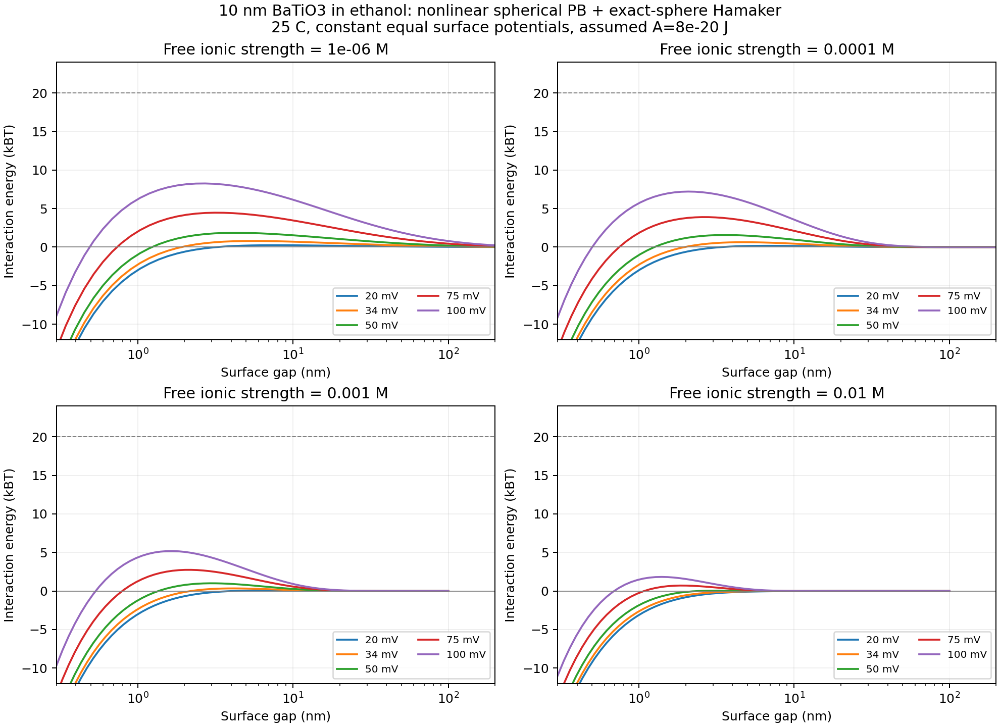
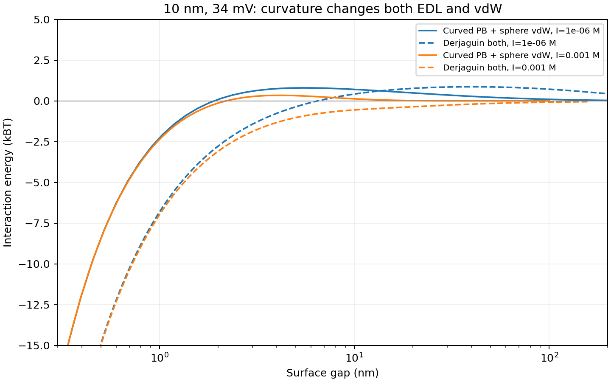
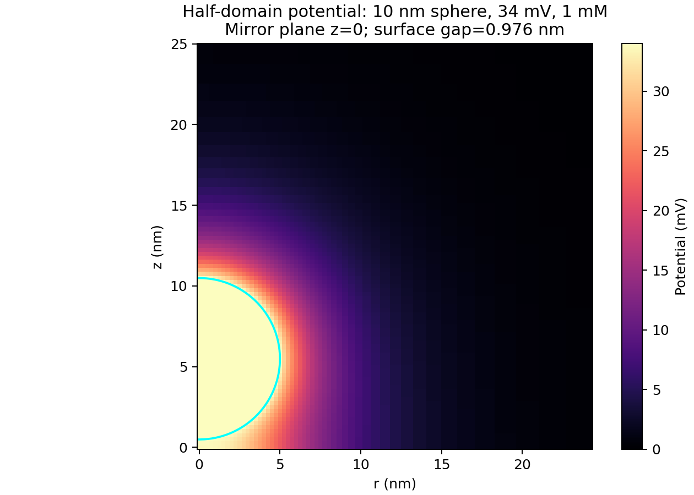

# 直径10 nmのBaTiO₃／エタノール：曲率を含むDLVO計算

## 計算結果

**曲率を含むDLVO計算は実行できました。今回の定電位モデル・入力範囲では、
無限遠基準の正の極大が20 kBTを超える候補はありませんでした。**
20 kBTは保存時間を保証する値ではなく、前の探索と共通の選別目安です。

中心ケースA=8×10⁻²⁰ Jで得た正のエネルギー極大は以下です。
電位はゼータ電位ではなく、両球に与えた一定の表面電位です。

| 表面電位の絶対値 | 自由イオン強度1 µM | 0.1 mM | 1 mM | 10 mM |
|---|---:|---:|---:|---:|
| 20 mV | 0.243 kBT | 0.172 kBT | 0.056 kBT | 0 |
| 34 mV | 0.796 kBT | 0.635 kBT | 0.337 kBT | 0 |
| 50 mV | 1.855 kBT | 1.566 kBT | 1.001 kBT | 0.051 kBT |
| 75 mV | 4.464 kBT | 3.891 kBT | 2.747 kBT | 0.709 kBT |
| 100 mV | 8.258 kBT | 7.207 kBT | 5.184 kBT | 1.828 kBT |

0はh≥0.3 nmの探索範囲で正の極大がなかった場合です。
弱い引力A=4×10⁻²⁰ Jまで含めた全60曲線での最大は、100 mV・1 µMで約8.61 kBTでした。
34 mVの場合はAの感度範囲全体でも最大約0.85 kBTでした。
極大は無限遠を基準にした値で、二次極小からの活性化障壁や凝集速度を直接計算したものではありません。



### 平板近似との違い

34 mV・1 mM・A=8×10⁻²⁰ Jでは、先の平板近似では正の極大がなかったのに対し、
今回の二球計算ではh≈4.17 nmに約0.337 kBTの極大が現れました。
曲率を扱うことで評価は変わりますが、この例で得た極大は熱エネルギーより小さい値です。



### 分散条件としての判断

この結果からは、実験報告に近い34 mV程度の電位について、
今回の定電位・裸の球のDLVOモデルだけで強い凝集障壁を説明するのは難しいと判断します。
ただし実測ゼータ電位から真の表面電位を確定できず、
実粉体のHamaker定数・表面電荷調節・吸着層も未測定です。
**「10 nmでDLVOが使えない」「10 nmが分散しない」という結論にはしません。**

実試料に進む場合は、一次粒径と溶液中凝集径を区別し、含水率・導電率・
電気泳動移動度・表面処理履歴を測ります。計算上は次に定電荷／電荷調節条件との比較、
実験上はエタノールで溶媒和する吸着層を持つ表面処理の比較が必要です。
具体的な添加剤の種類や量を、この定電位DLVO計算から確定していません。

## 今回解いた問題

**DLVO理論を維持し、Derjaguin平板近似を外して二つの球の周囲の電位を直接解きました。**
同じ半径5 nm・同じ一定表面電位の球が純エタノール相当の連続誘電体中にあるモデルです。
低電位近似も使わず、非線形Poisson–Boltzmann（PB）方程式を解きます。

| 入力 | 値 |
|---|---|
| 粒子直径 | 10 nm（物理的な球の直径として仮定） |
| 温度 | 298.15 K |
| 溶媒比誘電率 | 24.3 |
| 両球の表面電位の絶対値 | 20, 34, 50, 75, 100 mV |
| バルク自由イオン強度 | 1 µM, 0.1 mM, 1 mM, 10 mM |
| 自由イオン | 対称1:1電解質 |
| Hamaker定数 | 4, 8, 12×10⁻²⁰ Jの感度解析 |
| 最小表面間距離 | 0.3 nm |

Hamaker定数は**エタノール中で測定した値ではありません**。
前の[50–500 nmの探索](../batio3_ethanol/REPORT.md)と同じ不確かさの仮定です。
表面電位も入力パラメータであり、34 mVをゼータ電位から確定したわけではありません。
自由イオン強度は添加塩濃度と区別します。

## 方程式と力の求め方

球半径aで長さ、熱電位Vₜ=kBT/eで電位を無次元化します。
同一球2個の軸対称性と中央面の対称性を使い、上側半領域の(r,z)で解きます。

```text
u = psi / Vt, rho = r/a, xi = z/a, K = kappa a
u_rhorho + (1/rho) u_rho + u_xixi = K² sinh(u)
球表面: u = psi_surface/Vt
中央面z=0: u_z = 0
対称軸r=0: u_r = 0
十分遠方: u = 0
```

球表面と格子辺の交点は球の方程式から求めます。
球を階段状の物体に置き換えず、境界に接する差分の距離を実際の交点まで短縮します。
球付近は半径当たり20点を基本とし、遠方は間隔を徐々に広げます。
遮蔽長が短いときは、その長さ当たり8点以上も満たすように細分化します。
外側境界は球周辺の細かい領域から12 Debye長離し、零電位を与えます。
非線形方程式は疎行列の減衰Newton法で解きます。

中央面では軸方向電場がゼロなので、電気二重層の反発力は
浸透圧と半径方向電場によるMaxwell応力の和から求まります。

```text
F_EDL(h) = 2 pi epsilon Vt² integral_0^infinity
           rho [K² (cosh(u_mid)-1) + 0.5 (du_mid/drho)²] d rho
U_EDL(h) = integral_h^infinity F_EDL(H) dH
```

FはN、UはJです。等電位境界における相互作用自由エネルギーを、力の積分から求めます。
電場エネルギーだけを積分して定電位の電源仕事を無視する方法は使いません。
65点の距離で力を計算し、形状保存3次補間の積分でUを求めます。
積分上限はmax(100 nm, 12 Debye長)です。上限で残る遠方尾部は無視しています。

PB方程式、二球の軸対称領域、中央面応力の背景と検証値は
[Qiao, Li & Tang (2006), A finite difference scheme …](https://www.math.hkbu.edu.hk/~ttang/Papers/PBE_paper.pdf)を参照しました。
本コードの不等間隔格子・境界交点処理・Newton法は独自実装で、同論文のコードの再現ではありません。

## 引力も球同士の式に変更

中心間距離d=2a+hとして、非遅延・連続体・加算的Hamaker近似の球同士の式を使います。

```text
U_vdW(h) = -A/6 [2a²/(d²-4a²) + 2a²/d² + ln(1-4a²/d²)]
U_DLVO = U_EDL + U_vdW
```

これは球の形状を含む式ですが、完全な電磁Lifshitz計算ではありません。
h≫aのときの数値的な桁落ちを避けるため、実装では収束級数に切り替えます。
近接極限は−Aa/(12h)、遠方極限は−16Aa⁶/(9d⁶)です。

10 nm粒子・A=8×10⁻²⁰ Jでは、引力はh=0.3／1／5 nmで
約−18.86／−3.38／−0.112 kBTとなりました。
反発だけを曲率補正して引力を平板近似のまま残すと、比較が偏るため両方を変更しました。

## 数値検証

- 論文の非線形二球ベンチマーク（κa=5、κh=0.5、eψ/kBT=2）で、
  無次元力15.535に対し本コードは約15.565となり、差は約0.2%でした。
- 低電位・遠距離では、遮蔽された球の相互作用の先頭漸近項と比較します。
- 低電位で線形PBと非線形PBが一致すること、零電位で力がゼロになることを確認します。
- 半径当たり12／20／32点、および外側境界12／16 Debye長で代表条件を比較します。
- 球同士のHamaker式の接触側と遠方側の解析極限も検証します。

今回の代表3条件で、20点から32点への変更による力の差は約0.017–0.224%でした。
外側境界を12から16 Debye長へ広げた差は、代表3条件とも相対10⁻⁸未満でした。
力を3次補間で積分した結果と台形積分との差は、今回の正の極大位置で最大約0.032 kBTでした。
これは積分の独立な厳密誤差上限ではありません。

非線形ソルバーの残差収束と、格子・境界・力積分の誤差は別です。
代表条件での検証を全パラメータの一様な誤差保証とはみなしません。

## 実験への解釈で残る点

今回外したのは平板近似であり、DLVOの連続体・平均場としての限界は残ります。
電荷調節、特異吸着、自由イオンの会合、溶媒和／水和、吸着分子の立体反発、
電荷の離散性、強誘電性の追加相互作用、ファンデルワールス力の遅延は含めていません。
特に小粒子では平均電荷が少数の素電荷に相当することもあり、固定電位の実現性は別途確認が必要です。
0.3 nm近傍の連続体の予測も定量的に保証しません。

エタノール中で流体力学径8.3±0.3 nm、ゼータ電位+34.1±5.1 mVのBaTiO₃分散の
[実験報告](https://pmc.ncbi.nlm.nih.gov/articles/PMC8335646/)があります。
これは特定の合成・回収法の試料であり、物理的直径10 nm・定電位34 mVを保証するものではありません。
実験との違いを、曲率だけで説明できるかを今回の計算で調べます。

## 再現と保存ファイル

```bash
python -m pip install -e '.[research]'
python -m unittest discover -s tests -v
python -m studies.batio3_10nm
```

- [curves.csv](curves.csv)：自由イオン強度×電位×Hamaker定数の全エネルギー曲線
- [peaks.csv](peaks.csv)：正の最大値、位置、積分法の比較
- [summary.json](summary.json)：条件、極大、代表条件の格子・外側境界検証
- [energy_curves.png](energy_curves.png)：曲率を含むDLVO曲線
- [approximation_comparison.png](approximation_comparison.png)：先の平板近似との比較
- [approximation_comparison.csv](approximation_comparison.csv)：反発と引力を別々に比較する数値
- [potential_field.png](potential_field.png)：34 mV・1 mMでの電位分布
- [potential_field.npz](potential_field.npz)：同電位分布の数値配列


