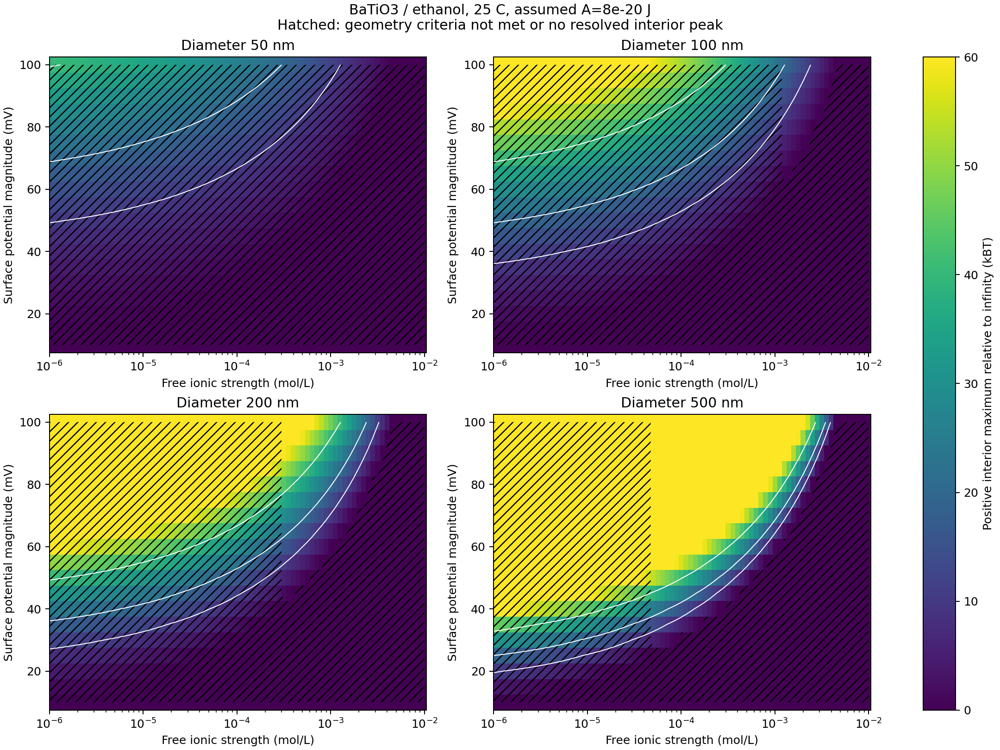
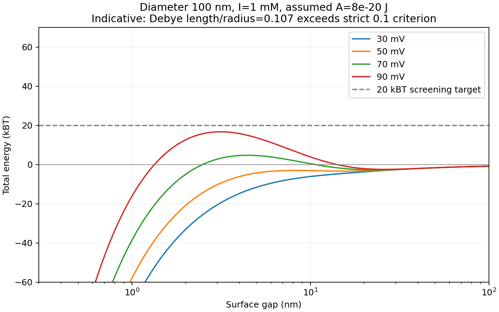

# BaTiO₃／エタノール：分散安定条件の探索

## 結論の位置づけ

**100 nm級BaTiO₃は、今回の仮定では静電反発だけに頼る条件が厳しく、吸着分散剤による立体反発の併用を優先する**のが計算と文献からの提案です。
まだ当該試料で安定分散を実証した結果ではありません。

計算上の具体的な候補は、**直径200 nm、表面電位の絶対値80 mV、自由イオン強度0.316 mM**です。
この点の正の極大は、A=4／8／12×10⁻²⁰ Jに対して約67.0／44.2／28.1 kBTで、
今回置いた3つのHamaker定数すべてで20 kBT目安を超え、幾何学的な近似判定も通ります。
ただしこの電位と自由イオン強度を同時に実現できる表面処理の特定は、別途測定が必要です。

これは未指定の粉体条件を範囲で置いた**凝集抑制条件のスクリーニング**です。
25℃の純エタノールを基準とし、粒径50–500 nm、表面電位10–100 mV、
自由イオン強度1 µM–10 mM、Hamaker定数4–12×10⁻²⁰ Jの18,468条件を計算します。
Hamaker定数・表面電位・自由イオン強度は当該試料の測定値ではありません。
吸着高分子による立体反発は計算に含めていないため、分散剤の最適量をDLVOだけから決定しません。

「無限遠基準の正の極大が20 kBT以上」を候補選別の目安とします。
これは保存時間を保証する閾値ではありません。粒子濃度、衝突頻度、二次極小、電荷調節、
粒度分布などで実際の凝集速度は変わります。粒子が凝集しなくても沈降は起こります。

## 文献値・仮定の区別

| 項目 | 値／範囲 | 扱い |
|---|---|---|
| 温度 | 298.15 K | 計算条件 |
| エタノール比誘電率 | 24.3 | 純エタノール25℃の代表値 |
| 粒子直径 | 50, 100, 200, 500 nm | 未指定なので仮定、半径ではない |
| 表面電位の絶対値 | 10–100 mV、5 mV刻み | 独立に振る入力。ゼータ電位との同一視はしない |
| 自由イオン強度 | 10⁻⁶–10⁻² mol/L、81点 | 対称1:1自由イオンを仮定、添加塩量とは異なる |
| 有効Hamaker定数 | 4, 8, 12×10⁻²⁰ J | 感度解析の仮定。エタノール中の確定値ではない |

エタノールの物性値は[メーカーの物性表](https://www.fishersci.com/us/en/scientific-products/selection-guides/chemicals/ethanol.html)を参照。
誘電率の実測研究には[Gregory & Clarke (2005)](https://doi.org/10.1088/0957-0233/16/7/013)があります。

BaTiO₃水系の研究ではHamaker定数約8×10⁻²⁰ Jが使われています。
ここでは感度解析の中心を置く参考に留め、エタノール中の値への換算根拠にはしません。
参考：[Yoshikawa et al. (2009)](https://doi.org/10.1111/j.1551-2916.2008.02647.x)。
今回の範囲外のHamaker定数もあり得るため、「全条件に頑健」とは解釈しないでください。

特殊な合成・回収法で得た小粒径BaTiO₃については、エタノール中の分散と正のゼータ電位が報告されています。
しかし市販の100 nm級粉末へ移せる物性値ではありません。
参考：[Comparison of Methods for Surface Modification … (2021)](https://pmc.ncbi.nlm.nih.gov/articles/PMC8335646/)。

## 非線形DLVOモデル

両表面で同じ定電位を与え、対称1:1電解質の非線形PB方程式を数値的に解きます。
表面間中央から表面までの半領域を使います。

```text
phi = e psi / (kBT), x = kappa h
d²phi/ds² = (x/2)² sinh(phi), 0 <= s <= 1
phi'(0) = 0, phi(1) = e psi_surface/(kBT)
P(h) = epsilon (kBT/e)² kappa² [cosh(phi_mid) - 1]
U_EDL(h) = pi a integral_h^infinity (H-h) P(H) dH
U_vdW(h) = -A a/(12h)
```

PBを境界値ソルバーで解き、圧力を2回積分して同一球のDerjaguin相互作用を求めます。
無次元距離κh=10⁻⁴–30の700点を用い、極大探索はh≥0.3 nmかつκh≤20で行います。
無限遠の積分をκh=30で打ち切り、遠方の指数減衰尾部を無視しています。
極大は離散格子上の値で、5 mV刻みの閾値も格子の分解能に制限されます。

PBの圧力・自由エネルギーの背景は[Chan (2002)](https://doi.org/10.1006/jcis.2001.7942)を参照。
本コードは同論文の解析積分アルゴリズムそのものではなく、同じPB方程式と圧力関係を境界値法で解きます。

**曲率に関する候補条件**として、Debye長/a≤0.1、極大位置h/a≤0.1、
解析範囲内部の極大であることを要求します。これは誤差の保証ではなく、
Derjaguin近似を極端に外れた結果を候補から除く保守的な判定です。
低塩側で高い障壁が出ても、二重層が粒径と同程度ならこの計算では確定しません。

非線形PBを使っても、イオン対形成・特異吸着・多価イオン相関・表面電荷調節・
Ba溶出・水和／溶媒和力・強誘電性に由来する追加相互作用は扱っていません。
エタノールでは**自由イオン濃度と添加塩濃度の区別**が特に必要です。
導電率から自由イオン強度へ換算する場合も、イオン種・移動度・解離を別途評価してください。
また電位とイオン強度を独立に振った数値条件が、実際の表面化学で同時に実現できるとは限りません。

## 計算結果

次表は20 kBT以上かつ曲率判定を通る条件のうち、**探索格子上で最も低い表面電位**の点です。
温度25℃、純エタノール相当、各電位に対して自由イオン強度を探索しています。

| 粒子直径 | A=4×10⁻²⁰ J | A=8×10⁻²⁰ J | A=12×10⁻²⁰ J | その点の自由イオン強度 |
|---|---:|---:|---:|---:|
| 50 nm | 候補なし | 候補なし | 候補なし | — |
| 100 nm | 80 mV | 100 mV（境界的） | 候補なし | 1.259 mM |
| 200 nm | 55 mV | 65 mV | 75 mV | 0.316 mM |
| 500 nm | 35 mV | 40 mV | 45 mV | 0.0501 mM |

「候補なし」は今回の電位10–100 mV、イオン強度範囲、距離範囲と近似判定の中での意味です。
より低塩の条件で分散しないことを証明するものではありません。
自由イオン強度を低下させると反発が長距離化しますが、二重層が厚くなり、
今回のDerjaguinモデルでは評価を確定できない領域へ入ります。
表の濃度は塩をこの量まで加える推奨値ではなく、計算上の比較点です。
特に100 nm・100 mV・A=8×10⁻²⁰ Jの最大値は20.20 kBTと目安のすぐ近くで、
物性値の不確かさを考えると実験の安定条件には採用しにくい点です。

Debye長は自由イオン強度1 µM／10 µM／0.1 mM／1 mM／10 mMで
約169.3／53.5／16.9／5.35／1.69 nmとなりました。



色は無限遠基準の正の極大です。白線は10／20／40 kBT、斜線領域は
曲率判定外または極大を解像できない点です。斜線領域の高い値だけを根拠に安定とは判断しません。



100 nm・1 mM・A=8×10⁻²⁰ Jの例は、Debye長/a=0.107で厳しい判定0.1を少し超えるため参考図です。
30／50 mVでは正の極大がなく、70 mVでは約4.75 kBT、90 mVでも約16.73 kBTです。
水系で使われるゼータ電位の経験的な目安を、そのままエタノール中BaTiO₃の安定保証に使いません。

## 実験で優先する条件

1. **溶媒と粉体の状態を固定**：同一ロットのエタノールと粉体で比較し、含水率と初期凝集径を記録します。
   含水率の最適値は今回の計算では決められません。純エタノールの誘電率だけで含水系を評価しません。
2. **吸着する分散剤を比較**：純エタノールに溶け、BaTiO₃へ吸着するリン酸エステルなどを候補とします。
   添加量0, 0.25, 0.5, 1, 2 wt%（粉体質量比）は初期探索用の提案で、文献確定の最適量ではありません。
   市販製品では有効成分換算とし、粉体比表面積と吸着量に基づいて調整します。
3. **同じ分散処理・温度で比較**：未処理凝集塊の存在と再凝集を分けて評価します。
   導電率、電気泳動移動度、適切なエタノール物性によるゼータ電位、粒度分布、粘度を測定します。
4. **24時間・7日などの目的時間で確認**：粒径の増大、沈降高さ、上澄み濃度、再分散性を記録します。
   低粘度だけでは安定とせず、急速沈降による見かけの低粘度を除外します。
5. **濃厚系は別確認**：希薄系で候補を絞ってから、実際の粉体濃度で粒度・流動性・保存性を確認します。

リン酸エステルの参考研究では、オレイル酸性リン酸エステル添加で分散改善が得られていますが、
溶媒は**トルエン／エタノール=80/20質量比**です。純エタノールでの最適量の実証ではありません。
参考：[Shibata et al. (2012)](https://www.jstage.jst.go.jp/article/rpsj/59/3/59_125/_pdf)。
PVB・高分子分散剤についても[エタノール／イソプロパノール混合系の研究](https://www.sciencedirect.com/science/article/pii/S0167577X02007693)があり、
純エタノールでは溶解性と吸着、架橋凝集を実験で確認する必要があります。

### 沈降と凝集の区別

例として密度BaTiO₃=6080 kg/m³、溶媒=789 kg/m³、粘度1.1 mPa·sを仮定すると、
孤立球のStokes沈降速度は直径100 nmで約2.26 mm/日、200 nmで約9.06 mm/日です。
ブラウン運動・容器・濃度・妨害沈降を無視した目安であり、上澄み生成速度の直接予測ではありません。
粒子が1 µmの緻密な凝集体になれば同じ仮定で約226 mm/日となります。
密度の参考：[BaTiO₃粉末を用いた研究の材料表](https://pmc.ncbi.nlm.nih.gov/articles/PMC7240485/)。
粘度は[エタノール物性表](https://www.fishersci.com/us/en/scientific-products/selection-guides/chemicals/ethanol.html)の25℃代表値に近い丸め値です。
「1週間沈降しない」などの要件には、凝集抑制に加えて粒径や粘度を検討する必要があります。

## 再現・出力

リポジトリ直下で実行します。

```bash
python -m pip install -e '.[research]'
python -m unittest discover -s tests -v
python -m studies.batio3_ethanol
```

- [scan.csv](scan.csv)：18,468条件、正の極大、近似判定、候補フラグ
- [curves.csv](curves.csv)：100 nm、1 mM、A=8×10⁻²⁰ Jの比較曲線
- [summary.json](summary.json)：入力条件・判定法と粒径／Hamaker定数別の最低電位候補
- [stability_map.png](stability_map.png)：A=8×10⁻²⁰ Jの条件マップ
- [energy_curves.png](energy_curves.png)：電位によるエネルギー比較

低電位の解析解との一致、非線形計算の格子収束、遠方漸近解との一致、正の反発の距離減衰をテストします。
