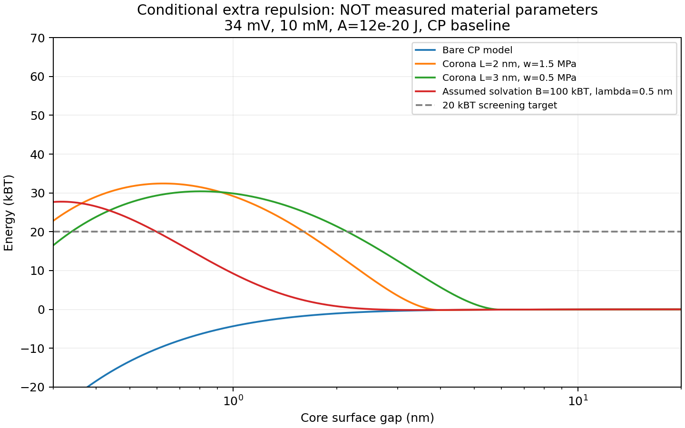
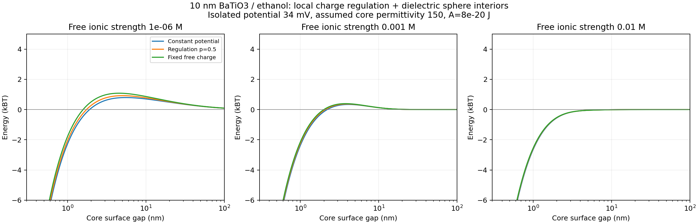
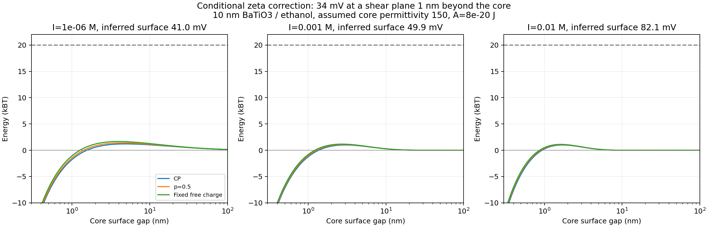
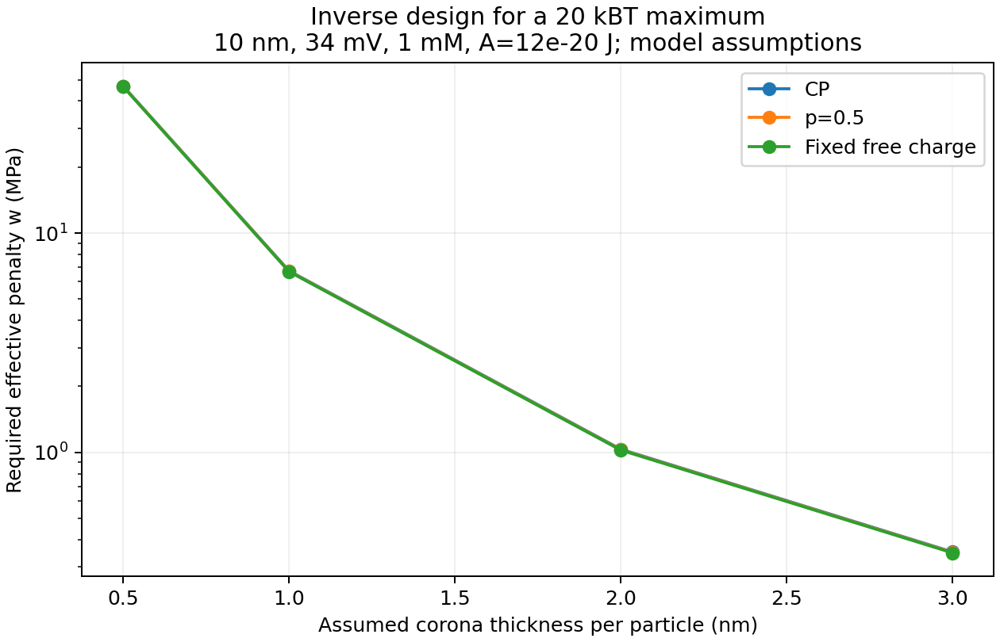

# 10 nm BaTiO₃／エタノール：電荷調節と溶媒和・吸着層を加えた評価

## 得られた条件と意味

**電荷調節、粒子内部の誘電応答、ゼータ電位と表面電位の差を考慮しても、
今回の裸の粒子の計算では20 kBTの選別目安に達しませんでした。**
一方、追加の反発を仮定した計算では、次の吸着層条件が候補になりました。

| 仮定した片側の層厚L | 仮定した反発係数w | 比較した条件の中で最も低い正の極大 |
|---|---|---|
| 2 nm | 1.5 MPa相当の有効エネルギー密度 | 約32.4 kBT |
| 3 nm | 0.5 MPa相当の有効エネルギー密度 | 約30.4 kBT |

**wは吸着層の重なりに対するモデル係数（J/m³）であり、実測の物性値ではありません。**
ここから特定の分散剤・添加量で安定になると断定していません。
この計算は「実際の吸着・溶媒和層がこの厚さと反発を持てば、モデル上では障壁を形成できる」
という逆算です。厚さ2–3 nmだけで安定が決まるわけでもありません。

上表は、直径10 nm、25℃、溶媒比誘電率24.3、
孤立粒子の表面電位34／50 mV、自由イオン強度1 µM／1 mM／10 mM、
Hamaker定数4／8／12×10⁻²⁰ J、調節パラメータp=0／0.5／1、
粒子比誘電率150の54個の基底条件について比較したものです。
連続した全濃度範囲や、実際のBaTiO₃表面化学を保証する結果ではありません。
20 kBTも保存時間を保証する閾値ではありません。



## 1. 電荷調節と粒子内部の誘電応答

従来の[曲率を含む定電位計算](../batio3_10nm/REPORT.md)を拡張し、各球の表面に局所的な電荷条件を与えました。
球内部はLaplace方程式、外部は非線形Poisson–Boltzmann（PB）方程式です。
表面で電位を連続にし、誘電変位の跳びを自由表面電荷に一致させます。

```text
球外: ∇²u = (kappa*a)² sinh(u)
球内: ∇²u = 0
u_out = u_in = u_surface
-∂n u_out + (epsilon_particle/epsilon_solvent) ∂n u_in = q_free
q_free = q_infinity - C_inner (u_surface-u_infinity)
C_inner = C_diffuse (1-p)/p
```

長さは球半径a、電位はkBT/e、自由電荷密度はepsilon_solvent(kBT/e)/aで無次元化しています。
nは粒子から溶液へ向く法線です。

- p=0：定電位。
- p=0.5：有限の表面化学容量を持つ線形電荷調節の例。
- p=1：各表面位置の自由電荷密度が一定。

比較の初期状態を揃えるため、各イオン強度・孤立表面電位について、
まず単独球の球対称非線形PBを解いてq_infinityを求めます。
C_diffuseは単独球の電荷の電位微分です。
この球の容量を使う線形調節モデルを採用しており、
特定の酸解離定数・サイト密度・Stern容量を当該試料へフィットしたものではありません。
調節パラメータの考え方は[Pericet-Camara et al. (2004)](https://doi.org/10.1021/jp0473063)を参考にしています。

球内部の調和電位はLegendre展開で扱い、表面電位から内部法線微分を計算します。
外部の法線微分は球面近傍の値を局所3次多項式で再構成します。
狭いすき間では中央面から球表面まで8区間を追加し、境界条件を解像します。
内部電位と外部PBの未知数を同時に解き、中央面の浸透圧・Maxwell応力から力を求めます。

### 電荷調節だけで変わる量

孤立表面電位34 mV、A=8×10⁻²⁰ J、粒子比誘電率150の場合です。
数値は無限遠基準の正の極大です。

| 自由イオン強度 | 定電位p=0 | 電荷調節p=0.5 | 定自由電荷p=1 |
|---|---:|---:|---:|
| 1 µM | 0.796 kBT | 0.920 kBT | 1.082 kBT |
| 1 mM | 0.337 kBT | 0.367 kBT | 0.392 kBT |
| 10 mM | 0 | 0 | 0 |

0は探索範囲で正の極大がない場合です。電荷調節を変えると反発は変化しますが、
このケースでは20 kBTまでの不足を埋めません。

粒子比誘電率も30／150／1000で比較しました。これは10 nm BaTiO₃の確定値ではありません。
1 mM・34 mV・定自由電荷・A=8×10⁻²⁰ Jでの極大は、
それぞれ約0.421／0.392／0.378 kBTでした。
等方・線形の粒子誘電応答として扱い、強誘電ドメインや異方性は解いていません。



## 2. ゼータ電位から表面電位への補正

ゼータ電位を粒子表面の電位として固定せず、
**孤立球のPB電位が、仮定したすべり面で34 mVになる**表面電位を逆算しました。
これは電気泳動移動度の完全な逆解析ではありません。

| すべり面を表面から1 nm外側とした場合 | 必要な孤立表面電位 |
|---|---:|
| 自由イオン強度1 µM | 約41.0 mV |
| 1 mM | 約49.9 mV |
| 10 mM | 約82.1 mV |

この補正した表面電位で、再び曲率・粒子内部誘電応答・電荷調節を含む二球PBを解きました。
A=8×10⁻²⁰ J、p=0／0.5／1での最大値は次のようになりました。

| 自由イオン強度 | 定電位 | p=0.5 | 定自由電荷 |
|---|---:|---:|---:|
| 1 µM | 1.205 kBT | 1.400 kBT | 1.654 kBT |
| 1 mM | 0.998 kBT | 1.091 kBT | 1.162 kBT |
| 10 mM | 0.993 kBT | 1.057 kBT | 1.108 kBT |

Hamaker定数の感度範囲全体でも、この補正後の最大は約2.19 kBTでした。
すべり面1 nmは未測定の仮定です。0–2 nmの位置についての換算表も保存しています。
10 mM・2 nmのケースは、表面電位10 kBT/eまでの探索で解が得られなかったため、数値を外挿していません。



## 3. 溶媒和反発を加える感度解析

正の単調な溶媒和反発の仮定として、粒子間エネルギーに次を加えます。

```text
U_solvation(h)/kBT = B exp(-h/lambda)
```

Bは仮想的なh=0でのペアエネルギー振幅、lambdaは減衰長です。
BaTiO₃／エタノールで測定した係数ではありません。
溶媒和力は表面・溶媒によって振動や引力も含むため、
この正の指数項は反発側の仮説を評価する簡略モデルです。
非水系で溶媒和力とイオン対形成が重要になる例として、
[シリカ／イソプロパノールでの直接力測定](https://doi.org/10.1103/PhysRevResearch.2.023315)があります。
その係数をBaTiO₃／エタノールへ転用していません。

1 mM・孤立表面電位34 mV・定電位・A=12×10⁻²⁰ Jについて、
20 kBTの極大を得るのに必要なBを逆算しました。

| 仮定する減衰長lambda | 必要なB | その位置h | 解釈 |
|---|---:|---:|---|
| 0.2 nm | 約211 kBT | 0.300 nm | 最小距離の端点で、障壁の位置を確定できない |
| 0.3 nm | 約128 kBT | 0.300 nm | 同上 |
| 0.5 nm | 約84.7 kBT | 0.356 nm | 分子距離に近く、連続体の定量性に制限 |
| 1.0 nm | 約54.5 kBT | 0.558 nm | 長めの反発範囲を仮定した条件 |

これは必要反発の大きさを示す表です。
純エタノールがこの反発を実際に生む、という予測ではありません。

## 4. 吸着層による立体反発を加える感度解析

粒子コア半径をa、片側の溶媒中の層厚をL、外側半径をb=a+Lとし、
二つの外側球が重なる体積V_overlapに対するペナルティを仮定します。

```text
d = 2a+h
V_overlap = pi (4b+d) (2b-d)² / 12,  d<2b
V_overlap = 0,                       d>=2b
U_corona = w V_overlap
```

形状の重なり体積は球で計算します。
ただしこれは**有効な吸着層ペアポテンシャル**であり、
グラフト密度・鎖長・溶媒質から導いた高分子ブラシの分子モデルではありません。
V_overlapは外側球の重なり体積で、殻材料だけの重なり体積ではありません。
コアによる排除・層の圧縮などの効果を有効係数wに含めます。
wの単位J/m³はPaと同じです。

同じ1 mM・34 mV・定電位・A=12×10⁻²⁰ Jについて、必要なwは以下です。

| 片側の層厚L | 20 kBTに必要なw | 極大位置h |
|---|---:|---:|
| 0.5 nm | 約46.8 MPa相当 | 0.300 nm、最小距離端点 |
| 1 nm | 約6.73 MPa相当 | 0.478 nm |
| 2 nm | 約1.03 MPa相当 | 0.751 nm |
| 3 nm | 約0.351 MPa相当 | 0.951 nm |

54個の基底条件すべてを比較した必要wの最大は、L=2 nmで約1.042 MPa相当、
L=3 nmで約0.355 MPa相当でした。そこに余裕を置いた仮定が冒頭の二つの例です。
その二例では、極大はh≥0.3 nmの探索範囲内部にありました。



PBのイオン分布はコア表面を基準とし、層は中性でイオンが透過すると仮定してペアエネルギーを加算しています。
層の電荷、誘電率、イオン排除、被覆によるHamaker定数の変化、
架橋凝集や余剰高分子による枯渇引力は計算していません。
溶媒和項と吸着層項には同じ物理的寄与が含まれ得るため、今回の主な比較では別々に評価しています。

## 5. イオン対形成と実験で確認する項目

自由イオン強度と添加塩濃度の差は、対称1:1塩の理想的な中性イオン対モデルで感度を示しました。

```text
c_total = c_free + K_association c_free²
I_free = c_free
```

例えば添加塩濃度1 mMに対し、仮定するKが0／10²／10⁴／10⁶ L/molなら、
自由イオン強度はそれぞれ約1／0.916／0.270／0.0311 mMです。
Kはエタノール中の実測値ではなく、活量、多価イオン、溶出、表面吸着もこの式には含みません。
実試料では導電率とイオン種・解離の評価が必要です。

実験候補は、エタノール中で吸着を保ち、**溶媒中で2–3 nm程度に広がる層**を作る表面処理です。
リン酸エステルの構造と非水溶媒中の溶媒和を扱った
[BaTiO₃のAIMD研究](https://www.sciencedirect.com/science/article/pii/S0169433223023255)があります。
ただし、その研究から今回のLやwを決定していません。
混合溶媒中でリン酸エステルによる分散改善を報告した
[Shibata et al. (2012)](https://doi.org/10.4144/rpsj.59.125)も、純エタノール・10 nmでの最適処方の証明ではありません。

確認は次の順序が適切です。

1. TEMなどの一次粒径、溶液中の凝集径、BET比表面積、含水率を測る。
2. 添加剤のエタノールへの溶解性、吸着量、余剰の未吸着成分を調べる。
3. 電気泳動移動度と導電率を測り、溶媒物性とすべり面の仮定を明示する。
4. 被覆後の流体力学径が、コア10 nmに対しておよそ14–16 nmか、凝集による増大でないかを確認する。
5. 粒径分布・沈降・粘度・再分散性を目的の保存時間で比較する。

添加量は粉体比だけでなく表面積で換算します。密度6080 kg/m³・直径10 nmの独立した球なら、
比表面積は約98.7 m²/gです。探索用の吸着量0.1／0.3／0.5／1 mg/m²は、
この表面積では粉体比で約1／3／5／10 wt%に相当します。
これは最適量の推奨値ではありません。実際のBET面積と吸着等温線で調整し、
100 nm粉体向けの添加率をそのまま10 nmへ流用しません。

## 数値検証と再現

24件のテストで、以前の定電位・論文ベンチマークに加えて、
調節パラメータの極限、定自由電荷、孤立球の弱電位極限、
球面法線微分、粒子内部の球調和関数、格子収束、
すべり面換算の弱電位解析解、イオン対形成の物質収支を確認しました。
代表的な1 nmのすき間で、半径当たり20点と48点の力の差は最大約0.64%でした。
極大・必要係数の全条件で一様に同じ誤差を保証するものではありません。
分子スケールでの連続体近似、少数電荷の離散性、実際の表面反応は別の不確かさとして残ります。

```bash
python -m pip install -e '.[research]'
python -m unittest discover -s tests -v
python -m studies.batio3_extended
python -m studies.batio3_zeta
```

力の計算はCSVに逐次保存します。保存済みの同じ入力・ソルバーの結果は再利用します。
ソルバーや主要入力が変わった場合は、既存の出力ディレクトリを移してから再計算します。

- [summary.json](summary.json)：モデル入力・極大・逆算係数・代表条件の検証
- [forces.csv](forces.csv)、[curves.csv](curves.csv)、[peaks.csv](peaks.csv)：電荷調節を含む数値
- [required_repulsion.csv](required_repulsion.csv)：溶媒和・層厚ごとに必要な反発強度
- [conditional_corona_examples.csv](conditional_corona_examples.csv)：二つの仮定した吸着層条件の全比較
- [isolated_charges.csv](isolated_charges.csv)：単独球の自由電荷と容量
- [zeta_mapping.csv](zeta_mapping.csv)、[zeta_corrected_peaks.csv](zeta_corrected_peaks.csv)：ゼータ電位補正
- [zeta_forces.csv](zeta_forces.csv)、[zeta_summary.json](zeta_summary.json)：補正後の二球計算
- [ion_pairing_sensitivity.csv](ion_pairing_sensitivity.csv)：未測定の会合定数を振った例
